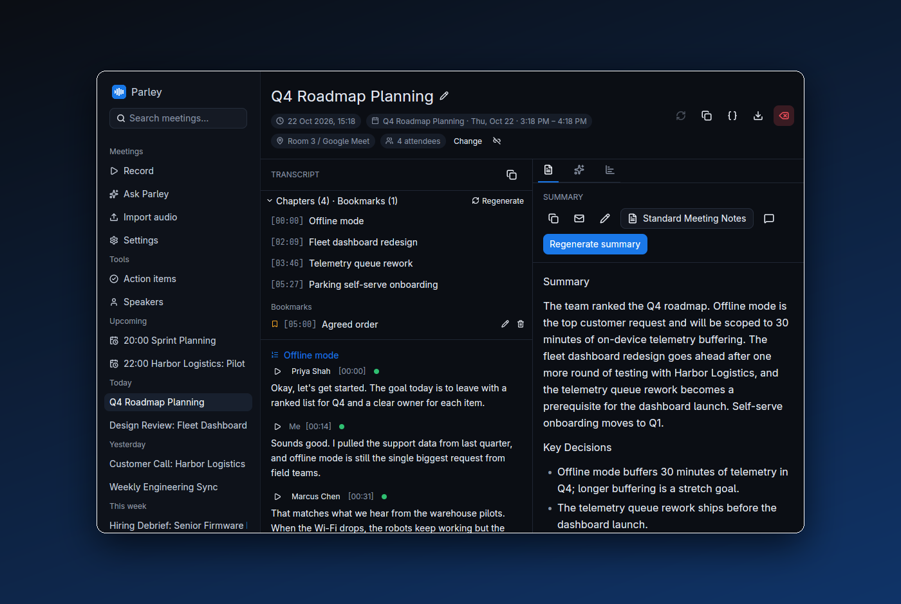
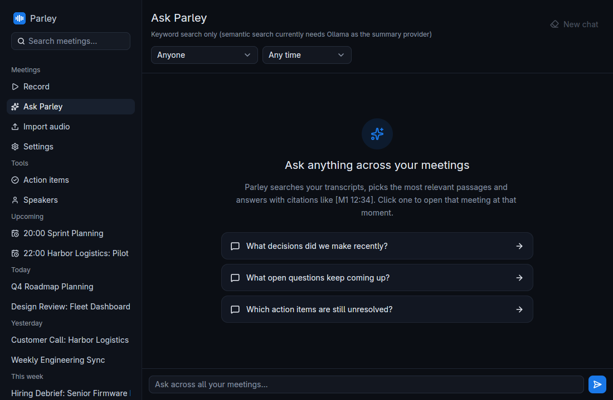
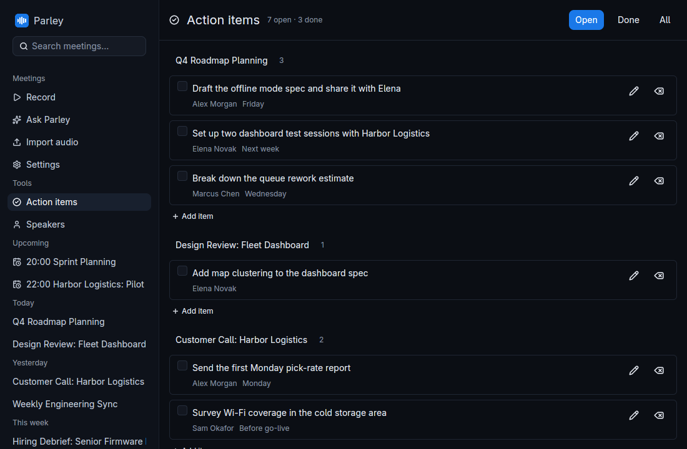
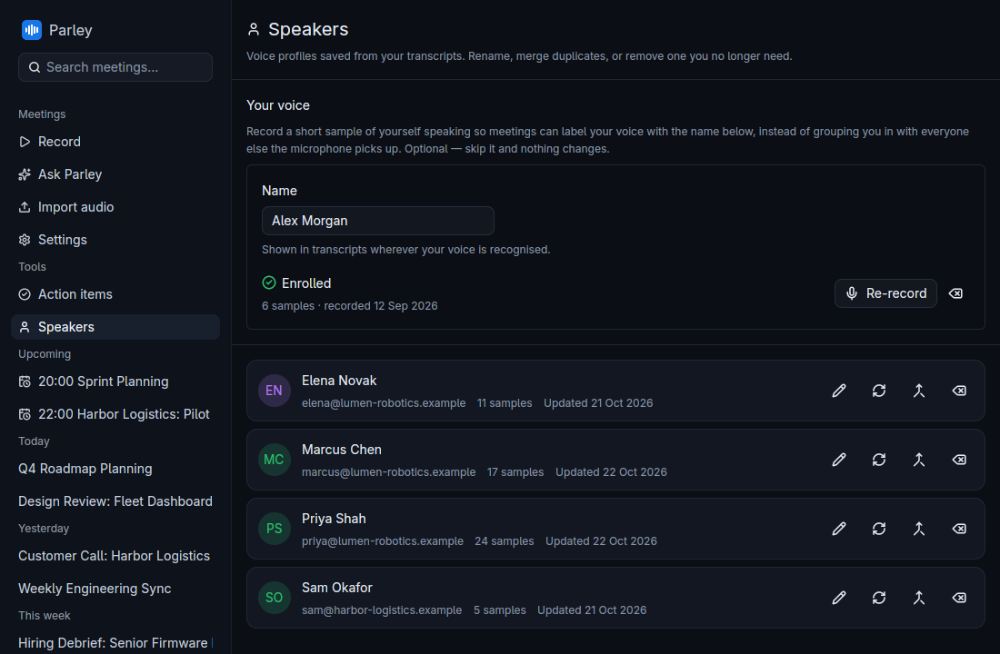
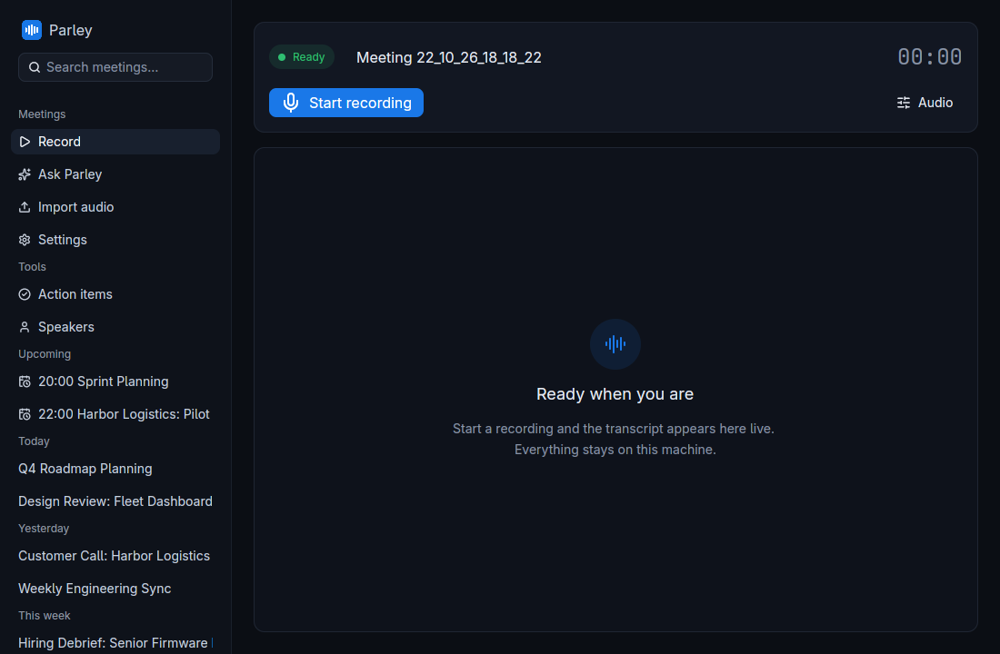

<div align="center" style="border-bottom: none">
    <h1>
        Parley — Privacy-First AI Meeting Assistant
    </h1>
    <a href="https://github.com/Hankanman/Parley/releases"></a>
    <a href="https://github.com/Hankanman/Parley/releases"></a>
    <a href="https://github.com/Hankanman/Parley/releases"></a>
    <br>
    <h3>Open Source • Privacy-First • Independent</h3>

A privacy-first AI meeting assistant that captures, transcribes, and summarizes meetings entirely on your local infrastructure. No cloud calls, no telemetry, no upsells — just an offline meeting tool that works.

**[meetparley.app](https://meetparley.app)** · [Download](https://github.com/Hankanman/Parley/releases/latest) · [30-second tour](https://meetparley.app/#video)



</div>

---

## Origins

**Parley** is an independent project. It started as a fork of [Zackriya-Solutions/meetily](https://github.com/Zackriya-Solutions/meetily) (the MIT-licensed "Meetily Community Edition") and has since been rebuilt and developed separately — it shares no infrastructure, releases or roadmap with that project. There is no commercial product: everything is and will remain MIT-licensed and free.

**How Parley departed from the original:**

- ✅ **Linux-only.** This fork dropped macOS/Windows support to focus on one platform done well — native PipeWire audio capture (mic + system, no cpal/BlackHole-style virtual device needed) and ALSA device enumeration all fixed and tested.
- ✅ **Native desktop shell.** No webview: the UI is [GPUI](https://www.gpui.rs/) (the framework behind Zed), talking to the Rust core in-process with no IPC/serialization overhead. The original Tauri + Next.js/React shell was retired once the GPUI app reached parity.
- ✅ **Modern dependencies.** `whisper-rs` 0.13 → 0.16 (drops ~30 MB of vendored patches), all crates current.

Credit for the original architecture, models, and significant feature work goes to [Sujith S](https://github.com/sujithatzackriya) and the original Zackriya-Solutions community. See [Acknowledgments](#acknowledgments).

---

## Introduction

Parley is a privacy-first AI meeting assistant that runs entirely on your local machine. It captures your meetings, transcribes them in real-time, and generates summaries — all without sending any data to a cloud you don't control. Suitable for professionals, teams, and individuals who need meeting intelligence without the privacy/compliance baggage of cloud meeting tools.

## Why this exists

While many meeting transcription tools exist, this one stands out by:

- **Privacy First** — All processing happens locally. No telemetry, no cloud round-trips by default.
- **Cost-Effective** — Uses open-source models (Whisper, Parakeet, local Ollama / llama.cpp) instead of metered APIs.
- **Flexible** — Works fully offline; supports any meeting platform (it captures system audio, not specific apps).
- **Customisable** — Self-host, fork, modify; everything is MIT.

## Features

- **Local-first** — All processing on your machine. No data leaves your computer unless you explicitly point it at a remote LLM endpoint.
- **Real-time transcription** — Live transcript as the meeting happens, via Whisper or Parakeet.
- **AI-powered summaries** — Generate meeting summaries with the LLM provider of your choice.
- **Linux-native** — built and tested on Linux; not available for macOS or Windows.
- **Open source** — MIT, no upsell.
- **Flexible AI providers** — Ollama (local, recommended), Claude, Groq, OpenRouter, or any OpenAI-compatible endpoint.
- **GPU acceleration** — NVIDIA (CUDA) or AMD/Intel (Vulkan), auto-detected by `build.sh`; falls back to CPU.

## Screenshots

All screenshots use the fictional demo data in [`parley-core/examples/demo/seed.sql`](parley-core/examples/demo/seed.sql); regenerate them with `scripts/showcase-screenshots.sh`.

| Ask across meetings | Action items |
|---|---|
|  |  |
| **Speakers** | **Record** |
|  |  |

## Installation

Pre-built binaries are published to this fork's [Releases](https://github.com/Hankanman/Parley/releases) page when tagged.

### 🐧 Linux

The `.AppImage` works on most distros (Fedora 43+, Ubuntu 22.04+, Arch, etc.):

Download `Parley-<version>-x86_64.AppImage` from the [latest release](https://github.com/Hankanman/Parley/releases/latest), then:

```bash
chmod +x Parley-*-x86_64.AppImage
./Parley-*-x86_64.AppImage
```

The `.deb` target is intentionally not shipped — it doesn't bundle `libsherpa-onnx-c-api.so`, so it wouldn't run on a clean host. The AppImage embeds all native libs via linuxdeploy and is the only supported bundle.

## Build from source

Clone, then run the all-in-one build script:

```bash
git clone https://github.com/Hankanman/Parley.git
cd Parley
./build.sh           # auto: CUDA on Linux with NVIDIA, CPU otherwise
./build.sh cuda      # NVIDIA explicit
./build.sh vulkan    # AMD/Intel
./build.sh cpu       # CPU only
./build.sh --help
```

`build.sh` handles the gnarly Fedora 44 / CUDA 13 build environment (gcc 16 → g++-15 host, `CUDAARCHS` for Turing+, `NO_STRIP=1` for linuxdeploy). On other distros you can override individual env vars.

To start fresh: `./clean.sh` (nukes `target/`; preserves user data and models).

For platform-specific deep-dives, see [`docs/building_in_linux.md`](docs/building_in_linux.md) and [`docs/BUILDING.md`](docs/BUILDING.md).

## Key features

### 🎯 Local transcription

Transcribe meetings entirely on your device using **Whisper** (ggml) or **Parakeet** (ONNX).

### 📥 Import & enhance `Beta`

Import existing audio files to generate transcripts, or re-transcribe any recorded meeting with a different model or language.

### 🤖 AI-powered summaries

Generate summaries with your choice of provider — local **Ollama** is recommended for full privacy, with Claude / Groq / OpenRouter / any OpenAI-compatible endpoint also supported.

### 🔒 Privacy-first by default

All audio, transcripts, models, and summaries stay on your machine. No telemetry. The only network traffic is what you explicitly configure (e.g. a remote Ollama endpoint or a cloud LLM API key you provide), plus one-off model downloads. See [PRIVACY_POLICY.md](PRIVACY_POLICY.md).

### 🎙️ Native PipeWire capture

Capture microphone and system audio at the same time, straight from PipeWire — no virtual devices. The mic runs through a speakerphone chain (echo cancellation against the system audio, noise suppression, automatic gain), and the two sources stay separate: mic on the left channel, system on the right, so "you" and "them" are never mixed together.

### ⚡ GPU acceleration

- **NVIDIA**: CUDA
- **AMD/Intel**: Vulkan
- **No GPU**: CPU fallback

Selected automatically at build time by `build.sh` (or pass `cuda` / `vulkan` / `cpu` explicitly).

## System architecture

Parley is a single self-contained GPUI desktop application:

- **`parley-core`**: audio capture, mixing, VAD, Whisper/Parakeet inference, SQLite persistence, summary/LLM providers — no UI dependency.
- **`parley-gpui`**: the native [GPUI](https://www.gpui.rs/) desktop shell — meeting list, recording UI, settings — linking `parley-core` directly, no IPC.
- **No external server required** — meeting/summary persistence, transcription, and LLM calls all happen inside the same Rust process.

For more details, see [docs/architecture.md](docs/architecture.md).

## Contributing

PRs welcome. Open an issue first if you're planning a non-trivial change so we can align on direction. The bar for "non-trivial" is low — there's no review backlog and no "PRO" tier this needs to dodge.

If you're contributing a Linux fix, make sure `./build.sh` produces a working AppImage on your distro before opening the PR.

## License

[MIT](LICENSE) — same as the original project. Use this for your own purposes, fork it, ship it, sell support, whatever. Just don't claim you wrote the parts you didn't.

## Acknowledgments

This fork builds on substantial prior work:

- **[Zackriya-Solutions/meetily](https://github.com/Zackriya-Solutions/meetily)** — the Meetily Community Edition Parley was originally forked from. The original architecture, core feature set and Tauri/Rust scaffolding came from there. Lead author: [Sujith S](https://github.com/sujithatzackriya).
- **[Whisper.cpp](https://github.com/ggerganov/whisper.cpp)** — fast inference engine for Whisper.
- **[Screenpipe](https://github.com/mediar-ai/screenpipe)** — some audio capture code.
- **[transcribe-rs](https://crates.io/crates/transcribe-rs)** — additional audio plumbing.
- **NVIDIA** — for the **Parakeet** model.
- **[istupakov](https://huggingface.co/istupakov/parakeet-tdt-0.6b-v3-onnx)** — ONNX conversion of Parakeet.
- All contributors to the original community edition who shaped this codebase before the fork.

## Star history

[](https://star-history.com/#Hankanman/Parley&Date)
